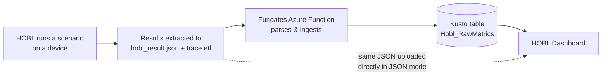
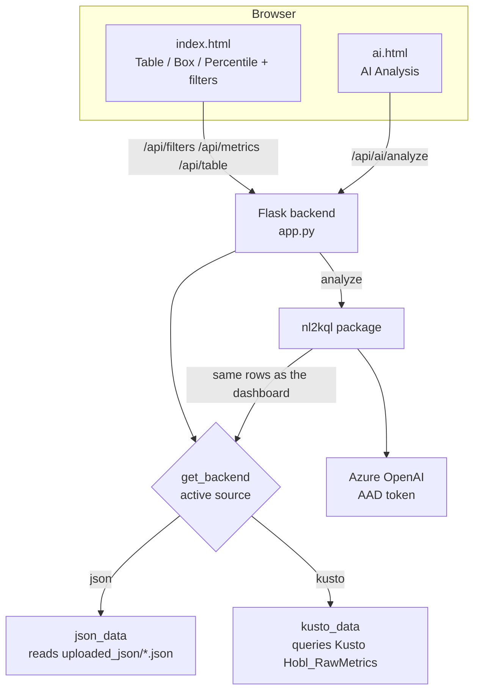
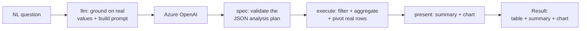

# HOBL Dashboard

A local web dashboard for exploring **HOBL** (Hardware-Optimized Benchmark Lab) power &
performance metrics from Windows device test runs. It has two halves:

- **Interactive viewers** — filter runs and inspect metrics as a **Table**, **Box & Whisker**
  plot, or **Percentile** view.
- **AI Analysis** — ask a question in plain English (e.g. *"compare system power between the
  two devices"*) and get a computed table, a written summary, and a chart.

Everything runs on `localhost`; no data is exposed externally.

---

## Who built what (handover)

| Area | Author |
|---|---|
| Core dashboard, **Kusto** + **JSON** data sources, runtime source switching, **Table / Box & Whisker / Percentile** viewers, filters (device, RAM, scenario, host, date, iteration) | **Ananya Agarwal** |
| **AI Analysis** feature (natural-language → analysis) and the `nl2kql/` package | **Aditya Raj Sharma** |

Every commit keeps its original author — run `git log` or use GitHub **Blame** to see line-level attribution.

---

## Table of contents

1. [End-to-end data flow](#end-to-end-data-flow)
2. [Application architecture](#application-architecture)
3. [Data sources (JSON vs Kusto)](#data-sources-json-vs-kusto)
4. [Feature 1 — Dashboard viewers](#feature-1--dashboard-viewers)
5. [Feature 2 — AI Analysis (`nl2kql`)](#feature-2--ai-analysis-nl2kql)
6. [Project structure](#project-structure)
7. [API endpoints](#api-endpoints)
8. [Configuration](#configuration)
9. [Setup & run](#setup--run)
10. [Authentication](#authentication)
11. [Handover notes](#handover-notes)

---

## End-to-end data flow

The dashboard is the final consumer of a pipeline that starts with HOBL running a scenario:



The dashboard can read the metrics from **two** places (see [Data sources](#data-sources-json-vs-kusto)):
the **Kusto** table (final source) or **uploaded JSON** result files (a stand-in used until the
new Kusto columns are deployed).

---

## Application architecture



**Key idea — one pluggable data surface.** Both backends (`json_data`, `kusto_data`) expose the
**same** functions and record shape:

- `get_filter_options()` — distinct values for every filter
- `get_metrics(...)` — one row per metric, matching the filters
- `get_table_data(...)` — per-iteration transposed columns for the Table view

Because the surface is identical, the routes, the frontend, **and** the AI feature work the same
regardless of the active source.

---

## Data sources (JSON vs Kusto)

### Missing usable RAM in build 26708.1000

The viewer repairs **only missing** usable RAM for build `26708.1000` at read
time, before filtering or grouping. Existing non-empty values and other builds
are unchanged. The explicit device mappings are:

| Device | Usable RAM |
|---|---|
| ROM-MS-IDC-25 | 16 GB |
| QC-LAM-PURWA-01 | 16 GB |
| QC-LAM-PURWA-03 | 8 GB |
| ITL-PTL-MAA-07 | 32 GB |
| LEN-WCL-FUN-01 | 8 GB |

For other devices, missing values use the most frequent original non-empty
usable RAM among strictly earlier iterations of the same canonical device in
this build only. Equal counts use the most recently observed RAM. Each result
counts once regardless of its number of metric samples; inferred values never
become evidence for later repairs. Kusto uses run timestamps (`RunDate`, falling
back to `BuildDate`); JSON uses `run_info.run_number`, since its upload date is
not the original run time. Without earlier evidence (or a usable ordering value),
RAM stays missing. Corrections apply consistently across filters, metrics,
table headers, AI analysis data, and regression comparisons. Source records and
uploaded files are not modified.

Switch the active source at runtime from the **top-right control** in the UI. The choice is
persisted to `runtime_state.json` and survives restarts.

| | **JSON mode** (default) | **Kusto mode** (final) |
|---|---|---|
| Backend | `json_data.py` | `kusto_data.py` |
| Reads from | JSON files you **upload** through the UI (stored in `uploaded_json/`) | The `Hobl_RawMetrics` Kusto table |
| Requires | Nothing — just upload `hobl_result*.json` | VPN + Azure AD RBAC on the cluster |
| Purpose | Stand-in until the new Kusto columns are deployed | Permanent production source |

In JSON mode the dashboard shows **no data until you upload** result files. Uploads can be cleared
from the same control.

---

## Feature 1 — Dashboard viewers

The main page (`/`, [templates/index.html](templates/index.html)) offers three ways to look at the
selected runs, backed by shared filter logic in [static/js/common.js](static/js/common.js):

| Viewer | File | Shows |
|---|---|---|
| **Table** | [static/js/table.js](static/js/table.js) | Per-iteration, Excel-style transposed metrics table |
| **Box & Whisker** | [static/js/box.js](static/js/box.js) | Distribution of a metric across iterations |
| **Percentile** | [static/js/percentile.js](static/js/percentile.js) | Percentile breakdown (P50/P70/P90, …) |

**Table (All Metrics)** preserves each original Kusto performance metric name,
including workload/R1 prefixes and sample suffixes. Names sharing a Perftrack ID
are shown as separate rows, with their own values and units, in the table and
its Excel export. **Table (Specified)** and curated plots continue grouping by
their mapped Perftrack IDs. Filters, missing metadata joins, and non-numeric
values can still affect which results are available.

**Filters** (all optional; an omitted filter means "all"): `device`, `ram`, `scenario`, `host`,
`build`, `start_date`, `end_date`, `last_n` (most recent N runs by run date), `start_iter`,
`end_iter`.

### Build regression

Select **Build Regression** in the dashboard's **View** dropdown (on `/`). Choose exactly
one device, RAM configuration, and scenario using the cascading dropdowns. Every available
metric shown by **Table (Specified)** is selected and compared automatically. Open the metric
picker to remove individual metrics, restore the specified-table selection, select every
available metric, or clear the selection. Select **Lower is better** for power/latency or
**Higher is better** for battery life/FPS, then click **Compare Builds** after changing the
metric selection or comparison direction.

All available builds are also selected by default. Open the build picker to exclude individual
builds, select all builds again, or clear the selection. Comparisons are recalculated between
the remaining builds, so the previous-build column always refers to the preceding included
build.

Optionally check **Exclude builds with fewer than 8 iterations**, then click
**Compare Builds** again. This affects only the regression graph and table:
all other views and source data keep every build. The count is the number of
iterations containing at least one finite sample of each selected metric, not
the number of metric samples. Builds with exactly 8 iterations remain included.
Comparisons are recalculated against the previous remaining build, and the view
reports how many builds were excluded. The option is off by default.

The page uses the active JSON or Kusto source and compares all available builds
in numeric build-number order, each against its immediate predecessor. P50 is the
median of each selected metric's finite samples across all hosts, dates, and
iterations within a build (performance samples are pooled, not medians of
iteration medians). Metric type, name, Perftrack ID, and unit identify a metric
so incompatible measurements are never pooled.

Results include P50, sample/iteration counts, signed absolute and percentage
changes, and regression/improvement status. A line-and-marker graph above the
table plots each build's P50, with builds in numeric order and the metric's unit
on the Y-axis. Markers highlight regressions (red), improvements (green), the
baseline (blue), and unchanged/not-comparable values (gray). Hover for counts and
build-to-build changes; missing samples leave gaps rather than joining across
missing builds. The graph supports zooming and image download.
Percentage change uses the absolute
previous P50 as its denominator; a zero previous P50 displays `N/A`.
Any worsening is labeled a regression, without a significance threshold or claim
of statistical significance. Builds missing the chosen metric stay visible and
are not skipped when determining the preceding build. Iterations without build
numbers and invalid samples are excluded with an explicit count.

The regular dashboard filters are hidden in this view; its dedicated single-select
filters apply instead. Switching back restores the regular filters and previously
loaded viewer data. Change/upload the data source using the shared header control;
applying a source change clears the regression selections. **Reload Filters** also
refreshes available devices. There is no standalone regression page.
`GET /api/regression` provides cascading options for a required
`device` and optional single-valued `ram`/`scenario`. Supplying one or more repeated
`metric` parameters (opaque keys from the returned options) requires `ram`, `scenario`,
and a `direction` of `lower` or `higher`, and adds one adjacent-build comparison result
per metric to the response. Optional repeated `build` parameters restrict every comparison
to those builds; omitting them includes all builds. A single metric also retains the original
top-level row fields.
The optional `exclude_under_8=1` enables the regression-only iteration filter;
omitting it or passing `0` includes all builds.

---

## Feature 2 — AI Analysis (`nl2kql`)

The AI page (`/ai`, [templates/ai.html](templates/ai.html)) turns a natural-language question into
a concrete, **read-only** analysis over whatever data source is currently active.



**How it stays accurate and safe:**

- The LLM only emits a small, **validated JSON spec** (filters / grouping / aggregation). It never
  runs code and never sees credentials.
- All numbers are computed **deterministically in Python** from real rows, so figures are never
  hallucinated.
- It reads rows through the **same** `backend.get_metrics(...)` the dashboard uses, so the AI always
  sees exactly what the dashboard shows.
- The operation is strictly read-only.

**Package layout** — public API is the single function `nl2kql.analyze(question, context, clarification, backend)`:

| Module | Responsibility |
|---|---|
| [nl2kql/__init__.py](nl2kql/__init__.py) | `analyze()` orchestrator — wires the pipeline together |
| [nl2kql/llm.py](nl2kql/llm.py) | Azure OpenAI access (AAD), data-grounding, prompt building |
| [nl2kql/spec.py](nl2kql/spec.py) | Validate the model's JSON plan; render the displayed KQL |
| [nl2kql/execute.py](nl2kql/execute.py) | Deterministic filter / aggregate / pivot / sort |
| [nl2kql/present.py](nl2kql/present.py) | Human-readable summary + chart selection |

An optional second LLM pass only **rewords** the already-computed summary (controlled by
`AI_SUMMARY_POLISH`); it can never change a number.

---

## Project structure

```
HOBL-Custom-Dashboard/
├── app.py                  # Flask app: routes + runtime data-source switching
├── config.py               # Configuration (see "Configuration" — ships with placeholders)
├── json_data.py            # JSON-file backend (upload-based stand-in)
├── kusto_data.py           # Kusto backend (final source)
├── generate_doc.py         # Generates DESIGN_DOCUMENT.md
├── requirements.txt        # Python dependencies
├── runtime_state.json      # Persisted active data source (git-ignored)
│
├── nl2kql/                 # AI Analysis backend (natural-language → analysis)
│   ├── __init__.py         #   analyze() orchestrator — the only public API
│   ├── llm.py              #   Azure OpenAI (AAD), grounding, prompts
│   ├── spec.py             #   validate spec + render displayed KQL
│   ├── execute.py          #   deterministic filter / aggregate / pivot
│   └── present.py          #   summary + chart selection
│
├── templates/
│   ├── base.html           # Shared header / layout
│   ├── index.html          # Dashboard (viewers + filters)
│   └── ai.html             # AI Analysis page
│
├── static/
│   ├── css/styles.css
│   └── js/
│       ├── common.js       # Shared filter + data-source logic
│       ├── table.js        # Table viewer
│       ├── box.js          # Box & Whisker viewer
│       └── percentile.js   # Percentile viewer
│
├── logos/ , static/img/    # Branding
└── uploaded_json/          # Uploaded JSON files in JSON mode (git-ignored)
```

---

## API endpoints

| Endpoint | Method | Purpose |
|---|---|---|
| `/` | GET | Dashboard page (viewers) |
| `/ai` | GET | AI Analysis page |
| `/api/datasource` | GET / POST | Get or set the active source (`json` \| `kusto`) |
| `/api/datasource/upload` | POST | Upload one or more JSON result files (JSON mode) |
| `/api/datasource/clear` | POST | Remove all uploaded JSON files |
| `/api/filters` | GET | Distinct values for every filter |
| `/api/metrics` | GET | Metrics matching the selected filters |
| `/api/table` | GET | Per-iteration transposed table data |
| `/api/ai/analyze` | POST | Run a natural-language analysis (`nl2kql`) |

All responses are JSON. Filter inputs are parsed/sanitized server-side.

---

## Configuration

All settings live in [config.py](config.py) and read from **environment variables** with safe
placeholder defaults, so the committed file never contains real infrastructure values:

| Setting | Purpose |
|---|---|
| `DATA_SOURCE` | Default source on first run (`json` or `kusto`) |
| `UPLOAD_DIR` | Where uploaded JSON files are stored (JSON mode) |
| `RUNTIME_STATE_FILE` | Where the runtime-selected source is persisted |
| `KUSTO_CLUSTER` / `KUSTO_DATABASE` / `KUSTO_TABLE` | Kusto connection (fill your own) |
| `HOST` / `PORT` / `DEBUG` | Flask server settings |
| `AZURE_OPENAI_ENDPOINT` / `_DEPLOYMENT` / `_API_VERSION` | Azure OpenAI resource for AI Analysis |
| `AI_SUMMARY_POLISH` | `1` = let the model reword the summary; `0` = fast offline template only |

> **Fill in your own values.** On a fresh clone, set the Kusto and Azure OpenAI values (via
> environment variables or by editing your local copy) — the repo ships **placeholders** like
> `<your-cluster>.kusto.windows.net`. Do **not** commit real internal endpoints to a public repo.

---

## Setup & run

**Prerequisites**
- Python 3.10+ (developed on 3.14)
- For **Kusto mode**: VPN + an Azure AD account with RBAC on the Kusto cluster
- For **AI Analysis**: an Azure AD account with access to an Azure OpenAI resource

```powershell
# from the repo root
python -m venv venv
.\venv\Scripts\Activate.ps1
pip install -r requirements.txt

# set your config values (see Configuration), then:
python app.py
```

Then open **http://127.0.0.1:5000**.

> `requirements.txt` lists `flask`, `azure-kusto-data`, and `azure-identity`. The AI feature also
> uses `requests`, which installs transitively with the Azure SDKs; if it's ever missing, run
> `pip install requests`.

---

## Authentication

- **Kusto mode** — Azure AD interactive browser sign-in (via `azure-identity`). A browser tab opens
  on the first query; the token is cached for the session. Only accounts with RBAC on the cluster
  can read data.
- **AI Analysis** — Azure AD token for Azure OpenAI (`DefaultAzureCredential`, falling back to an
  interactive browser sign-in). **No API key is stored.**

---

## Handover notes

- **`config.py` secrets.** In the original working copy, `config.py` was marked
  `git update-index --skip-worktree` so local real endpoints stayed **out of git** while the repo
  kept placeholders. On a fresh clone you supply your own values. Keep real internal endpoints out
  of any public repo.
- **Local/ignored files.** `runtime_state.json` and `uploaded_json/` are local and git-ignored.
- **Two backends, one surface.** `json_data` and `kusto_data` implement the same
  `get_filter_options` / `get_metrics` / `get_table_data`; switching sources needs **no** route or
  frontend changes.
- **`DESIGN_DOCUMENT.md`** is auto-generated by [generate_doc.py](generate_doc.py) and describes the
  original Kusto pipeline; this README supersedes it for the current app (JSON source, runtime
  switching, and AI Analysis).
